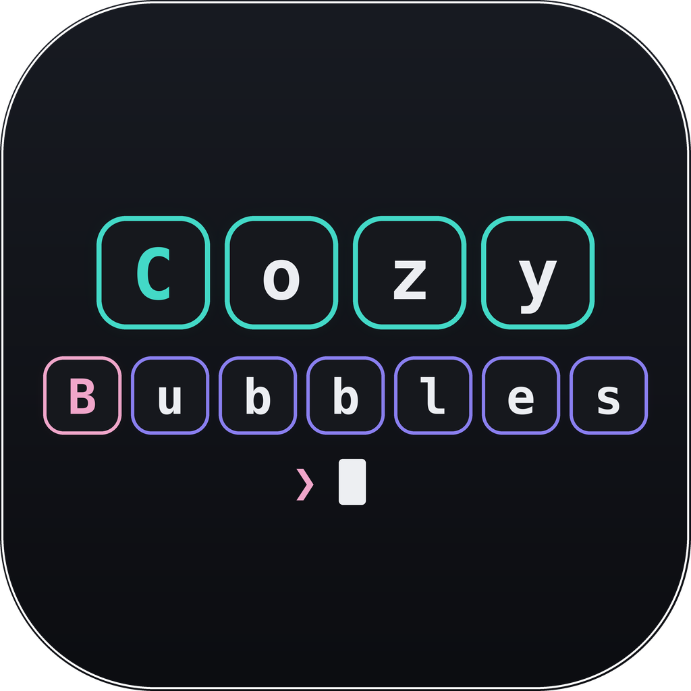

<p align="center">
  
</p>

<h1 align="center">CozyBubbles</h1>

<p align="center">A plugin for Claude Code that puts messages in cool bubbles.</p>

### Features

- **Interface:** messages from you, the client and Claude now live in cool bubbles.

<p align="center">
  
</p>

- **Images:** click an image you pasted, and it opens in Preview.
- **Code boxes:** when you or Claude write a code block, it looks like this:

<p align="center">
  
</p>

### Installation
#### In claude code session:
**_Run_**:
```text
/plugin install cozy-bubbles --marketplace varla-am/cc-plugin-cozybubbles
```
#### Outside claude code session:
**_Run_**:
```sh
claude plugin install cozy-bubbles --marketplace varla-am/cc-plugin-cozybubbles
```
### License
**_MIT_**
